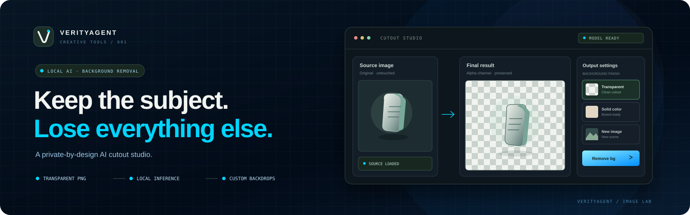
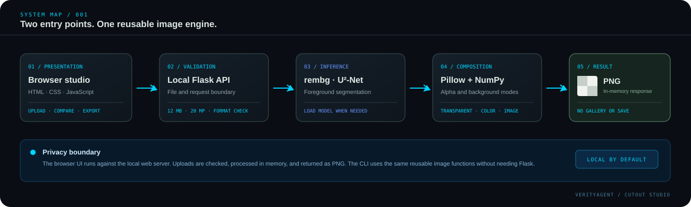

<p align="center">
  
</p>

<h1 align="center">VerityAgent AI Background Remover</h1>

<p align="center">
  <strong>Keep the subject. Lose everything else.</strong><br>
  An AI background-removal engine with a command-line interface and an optional premium browser studio.
</p>

<p align="center">
  <a href="https://github.com/muhammadsaeed-ai/verityagent-ai-background-remover/actions/workflows/ci.yml"></a>
  
  
  
  
</p>

**VerityAgent AI Background Remover** uses the pretrained U²-Net model through `rembg` to extract a foreground and preserve its alpha channel. Use the existing CLI for scripting and batch-style workflows, or launch the optional web studio for drag-and-drop image upload, live preview, background presets, and one-click PNG export.

No API key or hosted inference account is required. The first real inference may download model weights, and processing runs on the machine where you launch the application.

## Choose your workflow

| Entry point | Best for | Start command |
|---|---|---|
| **Command line** | Repeatable tasks, shell scripts, local automation | `python app.py --help` |
| **Browser studio** | Visual previews, drag-and-drop, color presets, custom backdrops | `python web_app.py` |

## The browser studio

<p align="center">
  
</p>

The browser interface is a custom HTML/CSS/JavaScript application, backed by Flask and the same reusable image operations used by the CLI. Its graphite-and-mint visual system includes a responsive workspace, source and result panels, checkerboard transparency preview, three background modes, HEX color presets, local model status, original/result comparison, and PNG export.

## Features

- **AI background removal** with `rembg` and the U²-Net model.
- **Transparent PNG** output with the generated alpha channel preserved.
- **Solid-color backgrounds** validated as `#RRGGBB`.
- **Custom-image backgrounds** fitted and center-cropped to match the foreground canvas.
- **Two interfaces:** a CLI for direct file workflows and a browser studio for interactive editing.
- **Reusable Python functions** for image loading, inference, composition, color parsing, and saving.
- **Helpful validation and errors** for unsupported formats, corrupt input, missing files, invalid colors, and incompatible output formats.
- **Offline unit tests:** inference is mocked in the test suite, so tests do not download AI weights.
- **Local-first web controls:** loopback binding, upload size/pixel limits, basic cross-origin checks, in-memory image processing, and no application gallery.

## Installation

Requires Python **3.10 or newer**.

### 1. Clone the repository

```bash
git clone https://github.com/muhammadsaeed-ai/verityagent-ai-background-remover.git
cd verityagent-ai-background-remover
python -m venv .venv
```

Activate the virtual environment.

**Windows PowerShell**

```powershell
.venv\Scripts\Activate.ps1
```

**Windows Command Prompt**

```bat
.venv\Scripts\activate.bat
```

**macOS / Linux**

```bash
source .venv/bin/activate
```

### 2. Install dependencies

For the CLI, install the AI image-processing dependencies:

```bash
python -m pip install --upgrade pip
python -m pip install -r requirements.txt
```

To use the optional browser studio, install Flask as well:

```bash
python -m pip install -r requirements-web.txt
```

The `rembg[cpu]` dependency installs CPU ONNX Runtime. A GPU is not required. The first real inference can take longer while the model weights are downloaded and initialized.

## Command-line usage

### See all options

```bash
python app.py --help
```

### Remove the background and export a transparent PNG

```bash
python app.py --input sample_images/person.jpg --output outputs/person.png
```

### Replace it with a solid color

```bash
python app.py --input sample_images/person.jpg --output outputs/person_mint.png --mode solid --color "#E0F0EA"
```

The accepted color format is six-digit HEX (`#RRGGBB`). The default solid color is `#FFFFFF`.

### Use a custom background image

```bash
python app.py --input sample_images/person.jpg --output outputs/person_scene.png --mode image --background sample_images/background.jpg
```

The replacement image is fitted and center-cropped to the foreground dimensions. If `--output` is omitted, the CLI writes a filename-derived result into `outputs/`. Put your own permitted source images in `sample_images/`; sample photos are not bundled.

## Launch the browser studio

After installing `requirements.txt` and `requirements-web.txt`:

```bash
python web_app.py
```

Open **[http://127.0.0.1:5000](http://127.0.0.1:5000)** in a modern browser. The interface runs on the local Flask server; stop it with `Ctrl+C`.

1. Upload a PNG, JPG/JPEG, WEBP, or BMP file by browsing or dragging it into the source panel.
2. Pick **Transparent**, **Solid color**, or **New image**.
3. Click **Remove background** and wait for the model to finish.
4. Compare the original and result preview, then export a PNG.

The web interface accepts up to 12 MB per image and rejects images above 20 megapixels. Browsers may support different image formats for previews; the underlying Python engine supports the formats listed in `config.py`.

## Web API

The browser app provides a small local API for its own UI.

| Endpoint | Purpose |
|---|---|
| `GET /` | Render the studio interface. |
| `GET /healthz` | Return a lightweight health response without loading the model. |
| `POST /api/remove-background` | Process a multipart image request and return a PNG. |

`POST /api/remove-background` uses `multipart/form-data` with these fields:

| Field | Required | Description |
|---|---|---|
| `image` | Yes | Source image, maximum 12 MB. |
| `mode` | No | `transparent` (default), `color`, or `image`. |
| `color` | For color mode | Six-digit HEX value such as `#F4F1EB`. |
| `background` | For image mode | Replacement image, maximum 12 MB. |

Example request:

```bash
curl -f -X POST http://127.0.0.1:5000/api/remove-background \\
  -F "image=@input.png" \\
  -F "mode=transparent" \\
  --output cutout.png
```

Successful PNG responses include `X-Output-Width`, `X-Output-Height`, `X-Transparent-Pixels`, and `X-Output-Format` headers. Expected validation errors are returned as JSON with an appropriate HTTP status.

## Reusable Python API

You can also use the processing functions independently of the CLI and web interface:

```python
from background_remover import (
    remove_background,
    replace_background_with_solid_color,
    save_image,
)

foreground = remove_background("sample_images/person.jpg")
result = replace_background_with_solid_color(foreground, "#E0F0EA")
save_image(result, "outputs/person_mint.png")
```

For a custom backdrop, use `replace_background_with_image(foreground, background_source)`.

## Tests and continuous integration

Run the offline tests with Python's standard library test runner:

```bash
python -m unittest discover -v
```

Tests use temporary images and mocked AI inference; the suite does not measure segmentation quality and does not download model weights. GitHub Actions runs the tests against Python 3.10, 3.11, 3.12, and 3.13.

## Privacy, safety, and limitations

- The CLI processes files locally. The web app binds to `127.0.0.1:5000` by default and rejects unexpected host values and cross-origin browser requests.
- Web uploads are validated by image contents and pixel dimensions, then processed in memory. The app does not create an image gallery or save web uploads into the repository.
- The `rembg` model may download and cache its weights on the local machine. Model files are not the same as uploaded source images.
- Local-first processing is not a substitute for machine security. Do not expose Flask's development server directly to the internet.
- Results vary with lighting, image quality, hair and other fine edges, transparency, and occlusion. A generated mask may need manual refinement for demanding production artwork.
- The web interface processes one source image per request. The project does not currently include batch UI, manual mask painting, user accounts, cloud storage, or hosted inference.

## Project structure

```text
verityagent-ai-background-remover/
├── app.py                    # CLI entry point
├── background_remover.py     # Shared image operations and AI inference
├── config.py                 # Defaults and supported formats
├── web_app.py                # Optional local Flask interface
├── requirements.txt          # CLI/model dependencies
├── requirements-web.txt      # Optional browser interface dependency
├── templates/index.html      # Studio markup
├── static/
│   ├── css/styles.css        # Responsive visual design
│   └── js/app.js             # Upload, preview, background modes and export
├── assets/
│   ├── cutout-studio-banner.svg
│   └── architecture.svg
├── tests/
│   ├── test_background_remover.py
│   └── test_web_app.py
└── .github/workflows/ci.yml
```

## License

Released under the MIT License; see [LICENSE](LICENSE). The license applies to this repository's original code and documentation. Review third-party dependencies and pretrained model terms before redistribution or commercial use.

---

<p align="center"><strong>Built by <a href="https://github.com/muhammadsaeed-ai">VerityAgent</a></strong><br><sub>Local-first AI tools with thoughtful UX and clear technical boundaries.</sub></p>
